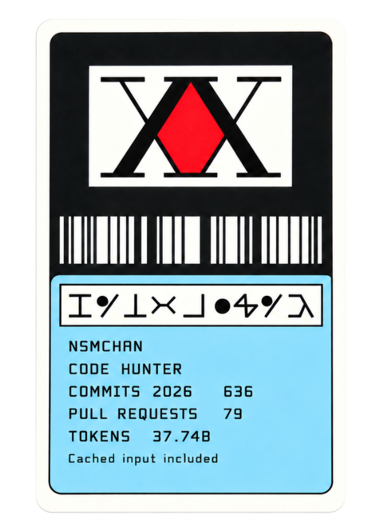
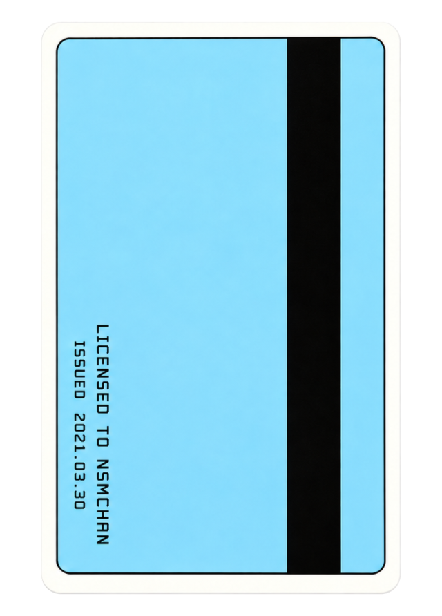

```text
 /\_/\
( -.- )
 / >💻
```

## nsmchan

<p>
  <a href="https://nsmchan.tistory.com/">blog</a>
  &nbsp;
  
</p>

<p align="left">
  
  &nbsp;
  
</p>

<p align="left">
<picture>
  <source media="(prefers-color-scheme: dark)" srcset="https://raw.githubusercontent.com/nsmchan/nsmchan/main/assets/water-divination-dark.svg?v=cb9a2ef9cc176143">
  <source media="(prefers-color-scheme: light)" srcset="https://raw.githubusercontent.com/nsmchan/nsmchan/main/assets/water-divination.svg?v=73128c36917911ac">
  
</picture>
</p>

<p>
<picture>
  <source media="(prefers-color-scheme: dark)" srcset="https://raw.githubusercontent.com/nsmchan/nsmchan/main/assets/ai-activity-dark.svg?v=cf7b4bea8df7a37a">
  <source media="(prefers-color-scheme: light)" srcset="https://raw.githubusercontent.com/nsmchan/nsmchan/main/assets/ai-activity-light.svg?v=d45ab0b24c946204">
  
</picture>
</p>

<table width="690" cellpadding="0" cellspacing="0">
<tbody><tr><td>
<a href="https://github.com/rtk-ai/rtk"><picture><source media="(prefers-color-scheme: dark)" srcset="https://raw.githubusercontent.com/nsmchan/nsmchan/main/assets/heading-rtk-dark.svg?v=1058c99e52f72970"><source media="(prefers-color-scheme: light)" srcset="https://raw.githubusercontent.com/nsmchan/nsmchan/main/assets/heading-rtk-light.svg?v=b9a65876aaa3f0dc"></picture></a><br>
<picture>
  <source media="(prefers-color-scheme: dark)" srcset="https://raw.githubusercontent.com/nsmchan/nsmchan/main/assets/compact-rtk-dark.svg?v=631eb91a599a937d">
  <source media="(prefers-color-scheme: light)" srcset="https://raw.githubusercontent.com/nsmchan/nsmchan/main/assets/compact-rtk-light.svg?v=6a11cddfc265110f">
  
</picture>
</td></tr></tbody>

<tbody><tr><td>
<a href="https://github.com/oraios/serena"><picture><source media="(prefers-color-scheme: dark)" srcset="https://raw.githubusercontent.com/nsmchan/nsmchan/main/assets/heading-serena-dark.svg?v=340b6a111acb78fd"><source media="(prefers-color-scheme: light)" srcset="https://raw.githubusercontent.com/nsmchan/nsmchan/main/assets/heading-serena-light.svg?v=36049998e60198e2"></picture></a><br>
<picture>
  <source media="(prefers-color-scheme: dark)" srcset="https://raw.githubusercontent.com/nsmchan/nsmchan/main/assets/compact-serena-dark.svg?v=7d0f358873780cef">
  <source media="(prefers-color-scheme: light)" srcset="https://raw.githubusercontent.com/nsmchan/nsmchan/main/assets/compact-serena-light.svg?v=3fa575b2214ea4ae">
  
</picture>
</td></tr></tbody>

<tbody><tr><td>
<a href="https://github.com/JuliusBrussee/caveman"><picture><source media="(prefers-color-scheme: dark)" srcset="https://raw.githubusercontent.com/nsmchan/nsmchan/main/assets/heading-caveman-dark.svg?v=bfbed975bbe2cec9"><source media="(prefers-color-scheme: light)" srcset="https://raw.githubusercontent.com/nsmchan/nsmchan/main/assets/heading-caveman-light.svg?v=5bfaee5902bb5c62"></picture></a><br>
<picture>
  <source media="(prefers-color-scheme: dark)" srcset="https://raw.githubusercontent.com/nsmchan/nsmchan/main/assets/compact-caveman-dark.svg?v=534cce055e1b12ad">
  <source media="(prefers-color-scheme: light)" srcset="https://raw.githubusercontent.com/nsmchan/nsmchan/main/assets/compact-caveman-light.svg?v=16c65116b845ccc6">
  
</picture>
</td></tr></tbody>
</table>
