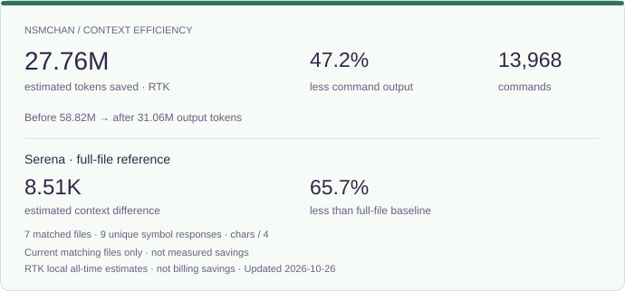

```text
 /\_/\
( -.- )
 / >💻
```

## nsmchan

<p>
  <a href="https://nsmchan.tistory.com/">blog</a>
  &nbsp;
  
</p>

<p>
<picture>
  <source media="(prefers-color-scheme: dark)" srcset="assets/github-stats-dark.svg">
  <source media="(prefers-color-scheme: light)" srcset="assets/github-stats-light.svg">
  
</picture>
</p>

<p>
<picture>
  <source media="(prefers-color-scheme: dark)" srcset="assets/ai-activity-dark.svg">
  <source media="(prefers-color-scheme: light)" srcset="assets/ai-activity-light.svg">
  
</picture>
</p>

<p>
<picture>
  <source media="(prefers-color-scheme: dark)" srcset="assets/context-efficiency-dark.svg">
  <source media="(prefers-color-scheme: light)" srcset="assets/context-efficiency-light.svg">
  
</picture>
</p>
